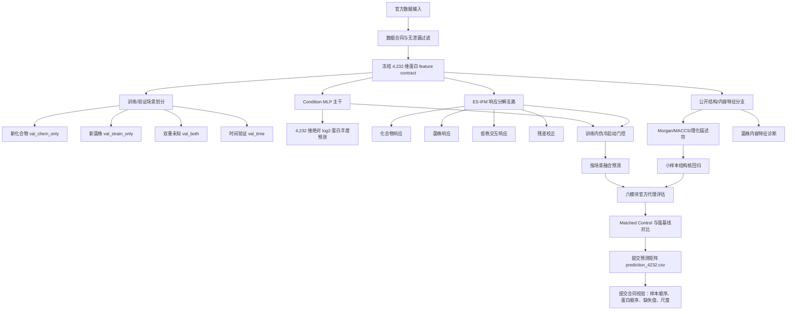
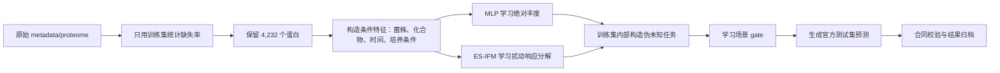
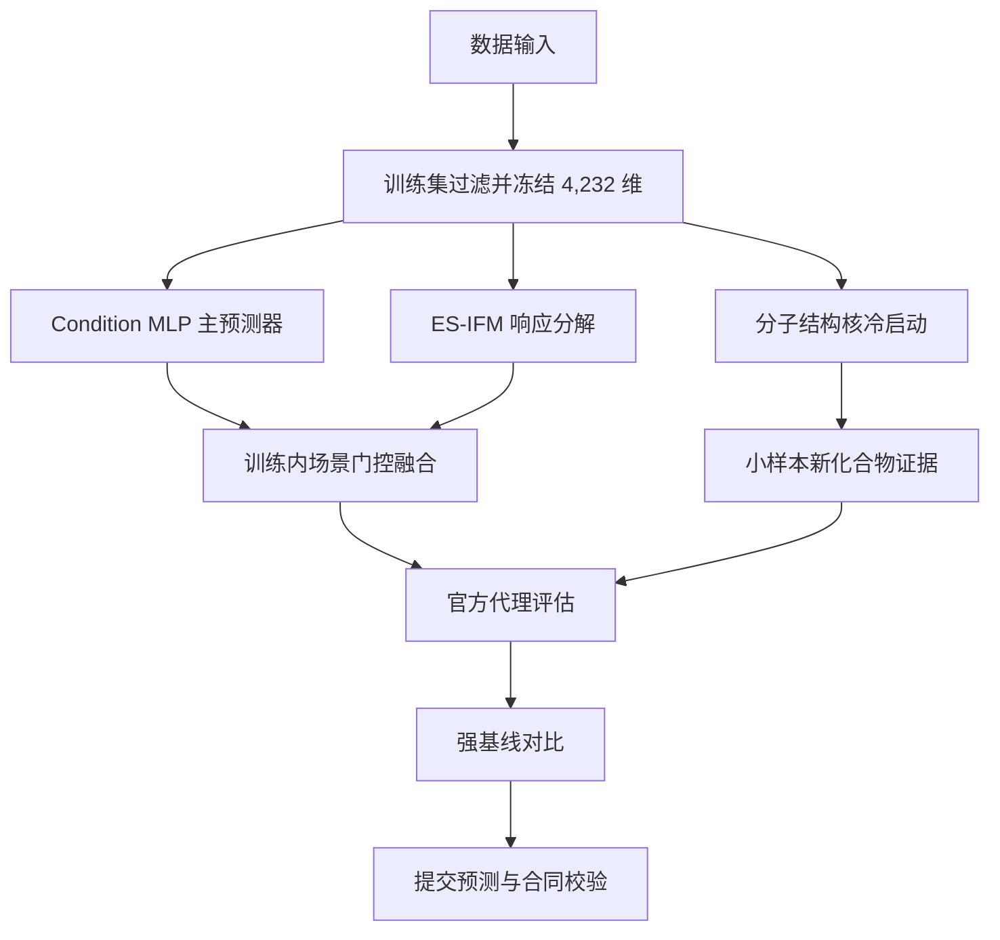

# GOAI 虚拟酵母初赛技术路线图

> 版本：2026-08-15  
> 输出维度：4,232 维蛋白质 log2 绝对丰度  
> 主提交模型：Condition MLP + 训练内门控 ES-IFM 融合  
> 方法亮点：场景化评估、ES-IFM 响应分解、小样本结构核冷启动、严格提交合同校验

## 1. 总体路线图

## 2. 方法分层

| 层级 | 目标 | 当前实现 | 作用 |
|---|---|---|---|
| 数据合同层 | 保证提交维度和顺序一致 | 训练集缺失率 `<0.697`，冻结 4,232 维蛋白列表 | 避免维度漂移和验证泄漏 |
| 强预测主干 | 提供最稳的官方样本级预测 | Condition MLP | 当前整体性能最强的提交基础 |
| 响应分解支路 | 提供可解释扰动建模 | ES-IFM-v4 | 拆分化合物、菌株、交互和残差响应 |
| 场景门控 | 不同验证场景采用不同融合比例 | 训练内伪冷启动估计 gate | 在新化合物、时间场景补充 ES-IFM 信息 |
| 内容特征分支 | 处理少样本/冷启动问题 | 分子结构核回归、菌株特征诊断 | 形成方法创新和边界分析 |
| 审计评估层 | 对齐官方要求和强基线 | 六模块代理、Matched Control、LightGBM、RandomForest、MLP 对比 | 支撑方案文档中的量化结论 |

## 3. 核心流程

## 4. 创新点落位

| 创新点 | 对应问题 | 实验结论 | 初赛表述建议 |
|---|---|---|---|
| ES-IFM 响应分解 | 普通 MLP 难解释化合物、菌株和交互贡献 | ES-IFM 可提供结构化响应表示，但单独性能弱于 MLP | 作为可解释扰动分解模块和融合支路 |
| 训练内场景门控 | 不同官方验证场景难度不同，单一模型权重不合理 | 门控融合在新化合物、时间场景相对有收益 | 作为无验证泄漏的场景自适应融合 |
| 小样本结构核 | 新化合物冷启动时 ID 表征不可用 | 在 16/20 个已知组合设置下有稳定配对提升 | 作为小样本新化合物预测的补充证据 |
| 强基线审计 | 官方要求超过或对比强基线 | 已系统比较 Matched Control、MLP、LightGBM、RandomForest、ES-IFM 系列 | 如实说明主提交强项与不足，避免夸大 |
| 负结果边界 | 主动学习、SINDy、高容量内容模型不一定稳定 | 给出可复现边界，减少方法堆叠 | 体现实验完整性和科学判断 |

## 5. 当前关键结果

| 场景 | Condition MLP RMSE | 门控融合 RMSE | Matched Control RMSE | 结论 |
|---|---:|---:|---:|---|
| 新化合物 | 0.321386 | **0.317841** | 0.352534 | 融合超过 MLP 与 Matched Control |
| 新菌株 | 0.465208 | **0.463059** | 0.377871 | 融合略优于 MLP，但未超过 Matched Control |
| 双重未知 | 0.484091 | **0.478575** | 0.355171 | 融合略优于 MLP，但未超过 Matched Control |
| 时间验证 | 0.322925 | **0.321832** | 0.409547 | 融合超过 MLP 与 Matched Control |

补充结果：结构特征直接进入高容量神经网络收益有限；强正则结构核在小样本新化合物设置中更稳定，16 个和 20 个已知组合时均获得显著配对提升。

## 6. 适合放入方案文档的简版图

## 7. 一句话技术路线

本方案以严格无泄漏的 4,232 维数据合同为基础，使用 Condition MLP 作为稳健主预测器，引入 ES-IFM 对化合物、菌株和交互扰动进行可解释分解，并通过训练集内部伪冷启动任务学习场景门控；同时利用公开分子结构特征构建强正则小样本核模型，补充新化合物冷启动证据，最终通过官方场景代理、强基线对比和提交合同校验形成可复现的初赛提交流程。
